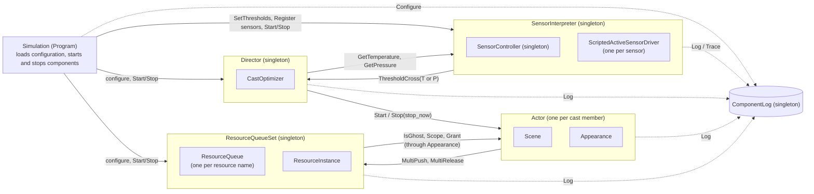
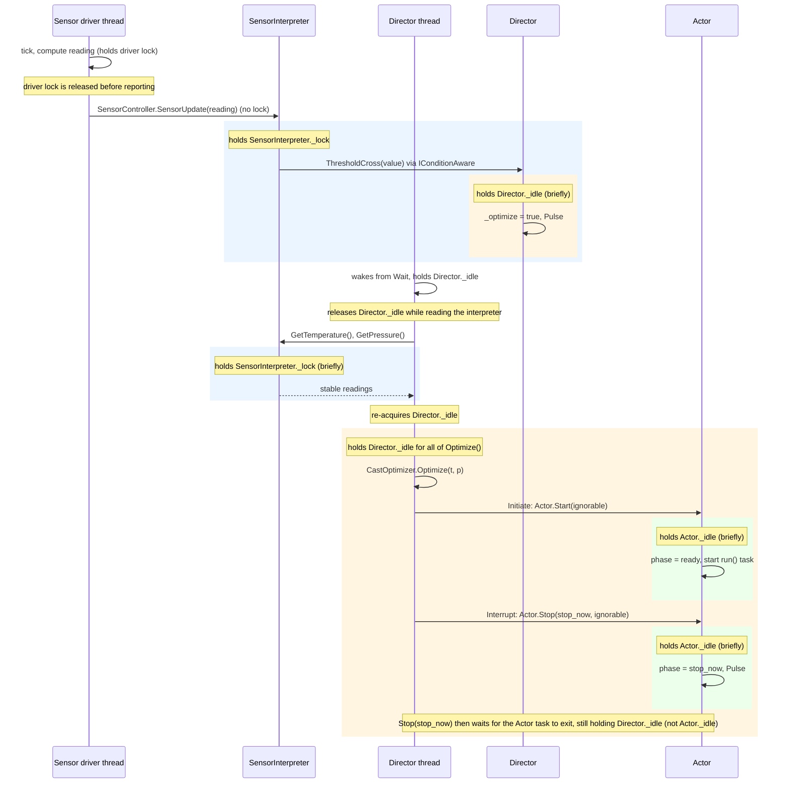
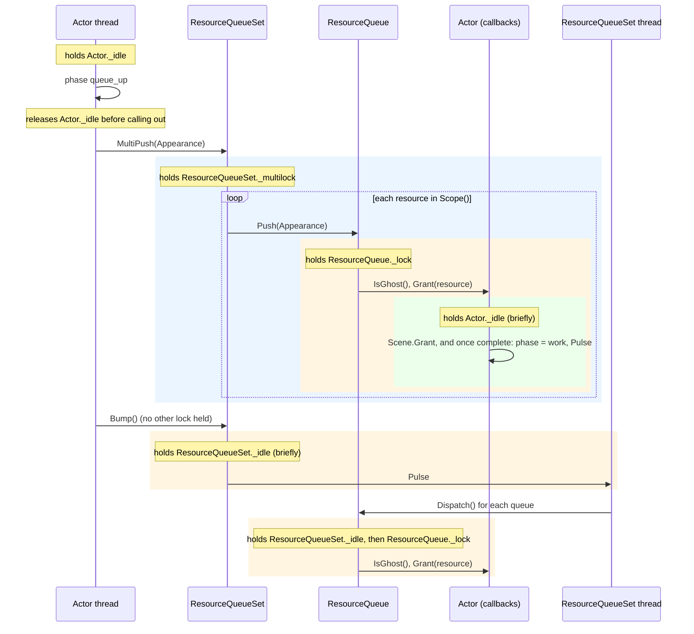

*author: Copilot*

*Subject: how the high-level components communicate and synchronize*

This page is plain Markdown; its diagrams are Mermaid blocks that GitHub renders directly. Names match `src/trifecta`.

## Information flow

Boxes nested inside a component are internals. They have no arrows because nothing outside their container
talks to them, so each can be replaced or changed without affecting the rest of the system. In particular, the
rest of the system receives only *interpreted* sensor readings: sensor hardware, drivers and the
`SensorController` are hidden behind the `SensorInterpreter`.

Solid arrows are calls between components; dashed arrows are calls over a singleton that nearly every
component makes (`ComponentLog.singleton`).

## Locking

Each component guards its state with its own lock (a `Monitor` on `_idle`, or a `Lock`). The sequence diagrams
below show who holds which lock while calling whom. Notes read as "holds X".

`Monitor` locks are reentrant, so a callback on the same thread into a lock it already holds would not
deadlock. No such callback exists today: `Actor` never calls the `Director`.

### Sensor reading to cast change

A sensor driver thread delivers a reading. If it crosses a threshold, the interpreter notifies the Director, which
wakes its own thread to re-optimize. The Director holds its own lock during `Optimize`, so that it can iterate the
cast, but it releases it while reading the interpreter (so the interpreter-to-Director and Director-to-interpreter
directions can never wait on each other).

Lock order on this path is `SensorInterpreter._lock` → `Director._idle` for notification, and
`Director._idle` → `Actor._idle` for cast changes. The reverse orders never occur. Because the Director waits for
a stopping Actor while holding its own lock, a threshold crossing that arrives meanwhile waits on
`Director._idle` while holding `SensorInterpreter._lock`, which in turn delays the sensor driver thread; it
resolves as soon as the Actor task exits.

### Resource request and grant

An Actor requests its scene's resources from its own thread, without holding its own lock. The queues call back
into the Actor to check and grant; those callbacks take only `Actor._idle`, which is never held while the
Actor calls out.

Lock order here is `ResourceQueueSet._multilock` → `ResourceQueue._lock` → `Actor._idle`, and
`ResourceQueueSet._idle` → `ResourceQueue._lock` → `Actor._idle`. Releasing resources (`MultiRelease`, via
`Actor.Remit`) takes `ResourceQueue._lock` → `Actor._idle` the same way, with the Actor's own lock released
first. `Actor._idle` is therefore always the innermost lock on these paths, and `ComponentLog`'s lock is a leaf
beneath every other lock.

### Shutdown

The simulator stops components in reverse of their start order: the Director (which stops its remaining
actors with `exit`, which does not wait for them), then the `ResourceQueueSet`, then the `SensorController`
(which stops each driver). Each component waits for its own thread after releasing its lock, so no stop call holds
a lock while waiting on that component's thread. The one exception is the `stop_now` wait noted above.
