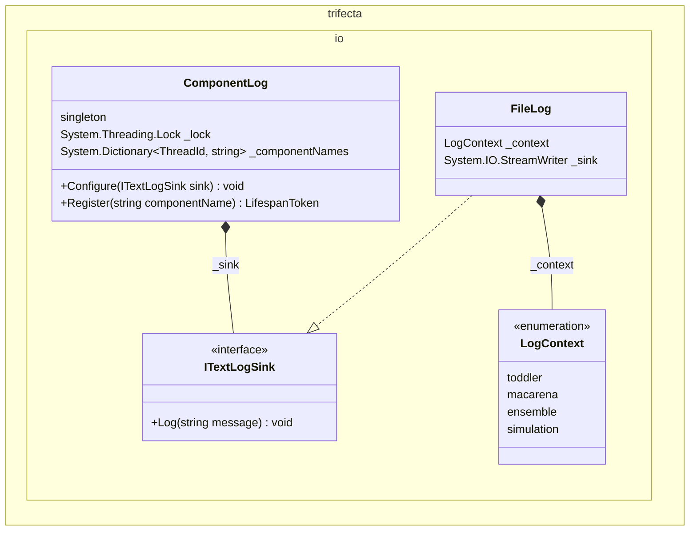

*author: Copilot*
*Author: Byron*

*Subject: outline I/O facilities for the application*

<!--- @context namespace trifecta.io --->
`namespace trifecta.io`

<!--- @context class ComponentLog --->
## ComponentLog

### Data Structure

<!--- @type --->
- class ComponentLog
  - types
    - using ThreadId = int
  - composition
    - [singleton]
    - System.Threading.Lock _lock
    - ITextLogSink _sink
    - System.Dictionary<ThreadId, string> _componentNames
  - operations
    - void Configure(ITextLogSink sink)
    - LifespanToken Register(string componentName)

<!--- @type --->
- class LifespanToken
  - inherits
    - IDisposable

<!--- @context class FileLogSink --->
## FileLogSink

### Data Structure

<!--- @type --->
- class FileLog : ITextLogSink
  - composition
    - LogContext _context
    - System.IO.StreamWriter _sink

## Prompt

A console interface for the user to query state and issue commands.

## CommandParser

Loads a sequence of commands from a structured file (e.g., JSON). Each command indicates a delay since the last
command, an action to take, and an optional tag string. Commands simulate manual oversight and administration of
the factory and are routed to static singletons (e.g., actor.Directory.instance()._____()).

## Interfaces

<!--- @type --->
- interface ITextLog
  - operations
    - void Log(string message)

<!--- @type --->
- interface ITextLogSink
  - operations
    - void Log(string message)

## Enumerations

<!--- @type --->
- enum LogContext
  - composition
    - toddler
    - macarena
    - ensemble
    - simulation

## Diagrams

