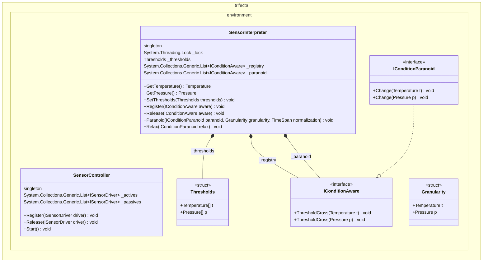
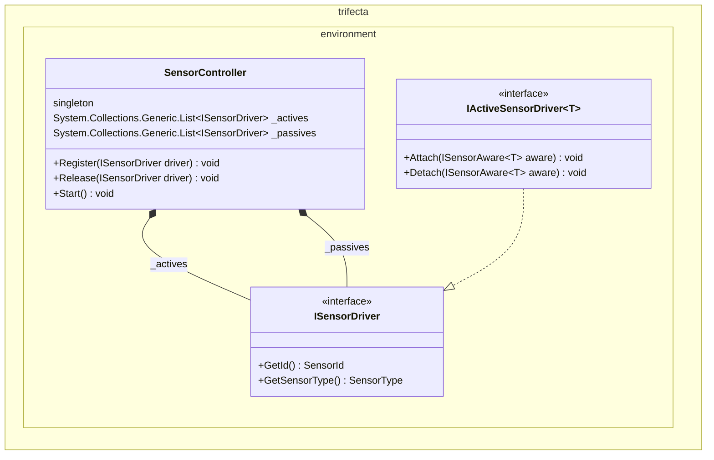

*author: Copilot*

*Author: Byron*

*Subject: outline an event model for an autonomous stage executor*

<!--- @context namespace trifecta.environment --->
`namespace trifecta.environment`

<!--- @context class SensorController --->
## SensorController

<!--- @type --->
- class SensorController
  - composition
    - [singleton]
    - System.Collections.Generic.List<ISensorDriver> _actives
    - System.Collections.Generic.List<ISensorDriver> _passives
  - operations
    - void Register(ISensorDriver driver)
    - void Release(ISensorDriver driver)
    - void Start()

<!--- @context class SensorInterpreter --->
## SensorInterpreter

<!--- @type --->
- class SensorInterpreter : ISensorAware<Temperature>, ISensorAware<Pressure>
  - composition
    - [singleton]
    - System.Threading.Lock _lock
    - Thresholds _thresholds
    - System.Collections.Generic.List<IConditionAware> _registry
    - System.Collections.Generic.List<IConditionAware> _paranoid
  - operations
    - Temperature GetTemperature()
    - Pressure GetPressure()
    - void SetThresholds(Thresholds thresholds)
    - void Register(IConditionAware aware)
    - void Release(IConditionAware aware)
    - void Paranoid(IConditionParanoid paranoid, Granularity granularity, TimeSpan normalization)
    - void Relax(IConditionParanoid relax)

<!--- @type --->
- struct Thresholds
  - composition
    - public Temperature[] t
    - public Pressure[] p

<!--- @type --->
- struct Granularity
  - composition
    - public Temperature t
    - public Pressure p

## Interfaces

<!--- @type --->
- interface IConditionAware
  - operations
    - void ThresholdCross(Temperature t)
    - void ThresholdCross(Pressure p)

<!--- @type --->
- interface IConditionParanoid : IConditionAware
  - operations
    - void Change(Temperature t)
    - void Change(Pressure p)

<!--- @type --->
- interface ISensorDriver
  - operations
    - SensorId GetId()
    - SensorType GetSensorType()

<!--- @type --->
- interface IActiveSensorDriver<T> : ISensorDriver
  - operations
    - void Attach(ISensorAware<T> aware)
    - void Detach(ISensorAware<T> aware)

<!--- @type --->
- interface ISensorAware<T>
  - operations
    - void SensorUpdate(SensorId id, T reading)

## Enumerations

<!--- @type --->
- enum SensorType
  - composition
    - temperature
    - pressure

<!--- @type --->
- enum SensorMode
  - composition
    - active
    - passive

## Diagrams

